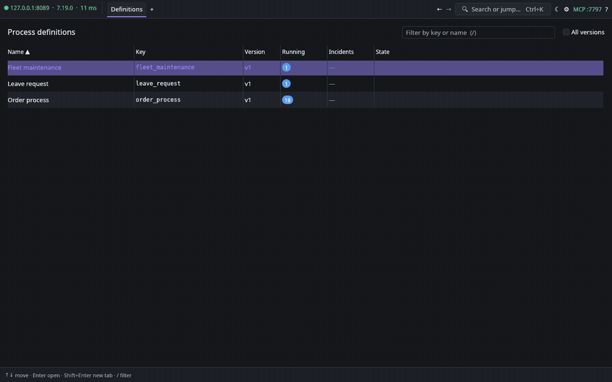

# Flightdeck

A fast, keyboard-first cockpit for Camunda 7. Native app, written in Rust.

Open a process, zoom without limits, find an instance by business key and jump to it, inspect
the element, step into the instance, change the language. All of it from the keyboard or the
mouse, against any Camunda 7 engine's REST API.

## Install

| Platform | Package |
|---|---|
| Arch Linux | `cd packaging/arch && makepkg -si` |
| Other Linux | `packaging/linux-generic/build.sh`, then `./install` from the archive, or `./run-in-place` |
| Windows | `packaging/windows/build.sh` (cross-built from Linux): `.msi`, or the `.zip` with `run-in-place.ps1` |

Then run `flightdeck`, add a connection (REST URL, user, password) and press Enter.

## Highlights

- Unlimited, smooth zoom at the cursor; labels never flicker or re-wrap.
- Everything reachable by keyboard: `?` lists the shortcuts.
- Ctrl+F finds elements and running instances (by business key or id) and shows why each match is highlighted.
- Every BPMN attribute, every variable, incident, job and task, with one-click copy.
- Token modification, batch operations, saved searches, light and dark theme.
- English, Russian and German; add a language by dropping a Fluent file in `locales/`.
- Built-in MCP server so an AI agent can operate the engine and the UI.

## More

- [Usage, shortcuts, settings, packaging and the MCP server](docs/USAGE.md)
- [Design](DESIGN.md)
- [Engineering principles](docs/RUST_DESKTOP_PRINCIPLES.md)

MIT licensed.
