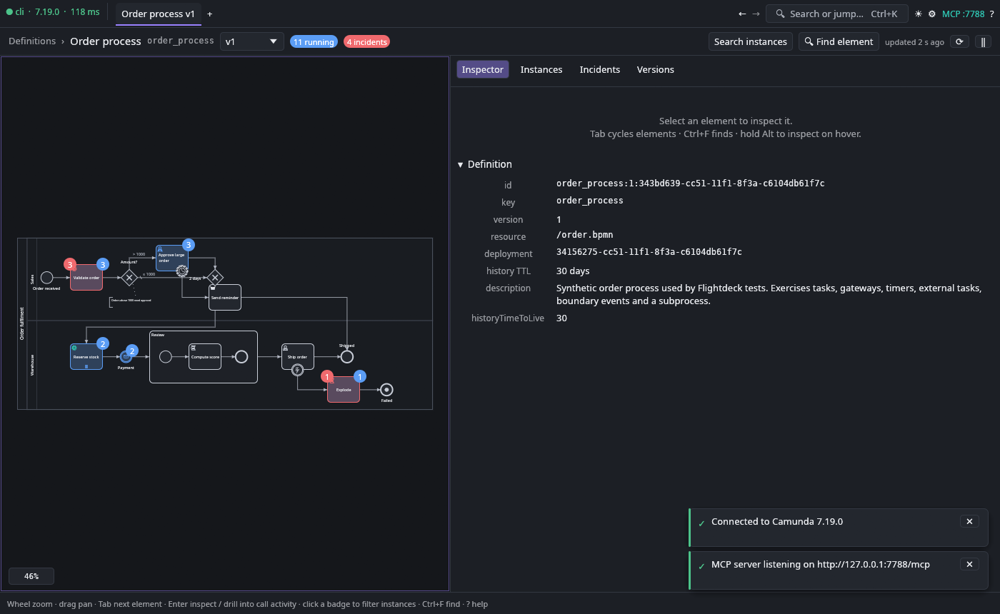
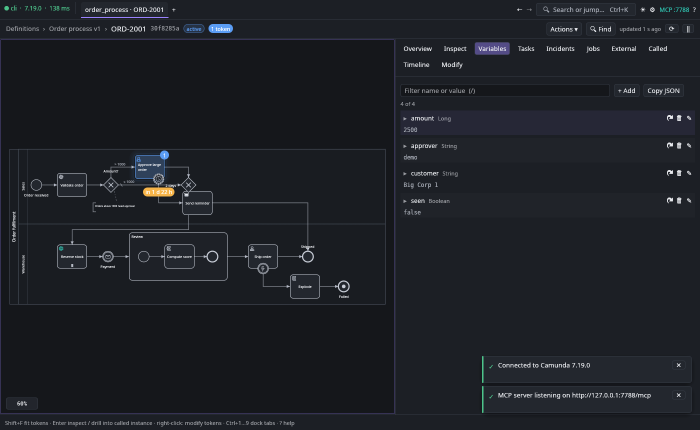
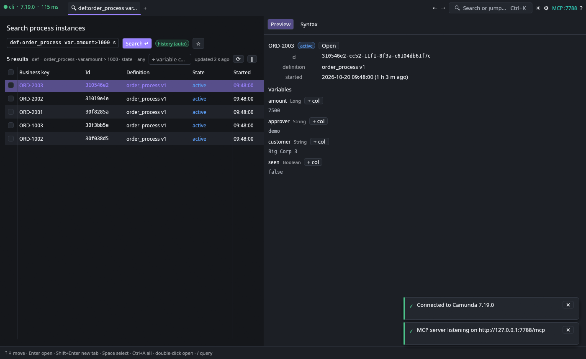

# Flightdeck

A fast, keyboard-first cockpit for **Camunda 7**, written in Rust (egui). It replaces the parts of
Camunda Cockpit you use every day and fixes the things that make Cockpit painful: unlimited smooth
zoom, keyboard navigation everywhere, every BPMN element parameter visible, element search inside
the diagram, a real instance search language, token modification and batch operations on the
Community Edition REST API.





## Highlights

- **Diagram** – zoom 0.5 % … 20 000 % at the cursor, smooth animated camera, inertial panning,
  keyboard pan/zoom (arrows / WASD / HJKL, `+` `−` `0` `1` `F`), level-of-detail rendering that
  keeps 600-node diagrams fluid, minimap, element ids and grid overlays, light and dark themes.
- **Element inspector** – id, name, documentation, `asyncBefore/After`, delegate/class/expression,
  topic, called element, timer/message/error/signal definitions (with humanised durations),
  gateway outgoing conditions in one table, multi-instance settings, input/output mappings,
  listeners, field injections, extension properties, form fields, raw XML. All click-to-copy.
- **Find element** (`Ctrl+F`) – by name, id, type, expression, implementation, documentation;
  non-matches are dimmed, `Enter` / `Shift+Enter` jump between matches, type filters.
- **Definitions** – running and incident counts per definition and per activity (badges on the
  diagram); click a badge to list the instances waiting there; version switcher.
- **Instances** – live tokens with glow, historic path (visited elements and inferred traversed
  flows), timers with countdown, incidents, variables (JSON tree, in-value search, typed editing,
  undo), user tasks (assign, claim, due date, complete), jobs (execute, retries, due date),
  external tasks (retries, unlock), called instances and ancestors, an activity timeline,
  token modification (start before/after, cancel, move) and restart of finished instances.
- **Search** – one query language with autocompletion, automatically routed to the runtime or
  history API: `def:order var.amount>1000 bk:ORD-* exec:Task_Validate state:finished started>-7d`.
  Variable values as result columns, row preview, saved searches, bulk suspend / activate /
  retry / delete / set variable as Camunda batches.
- **Incidents** and **Batches** places, a command palette (`Ctrl+K`), browser-like tabs with
  per-tab history (`Alt+←/→`, `Ctrl+T/W/Tab`), toasts with undo, a shortcut cheat-sheet (`?`).
- **Offline viewer** – `flightdeck some.bpmn` opens a diagram without an engine.

## AI agents (MCP)

Flightdeck has a built-in [MCP](https://modelcontextprotocol.io) server. Toggle it with the
`MCP` pill in the top bar, in *Settings → MCP server*, or start with `cockpit --mcp`
(default port 7788, optional bearer token). It exposes 55 tools: engine tools
(`list_definitions`, `get_element`, `find_elements`, `search_instances`, `get_instance`,
`get_variables`, `set_variable`, `retry_job`, `modify_instance`, `batch`, …) and UI tools
(`ui_state`, `ui_navigate`, `ui_select`, `ui_fit`, `ui_find`, `ui_dock`, `ui_filter`,
`ui_key`, `ui_type`, `ui_command`, `ui_screenshot`, `ui_confirm`, …). Destructive tools need
`confirm: true`.

```sh
# Claude Code (user scope) — the repo also ships a project-scoped .mcp.json
claude mcp add --transport http flightdeck http://127.0.0.1:7788/mcp
# stdio-only clients
cockpit --mcp-stdio http://127.0.0.1:7788/mcp
# exercise the server like an agent would
python3 scripts/mcp_smoke.py
```

## Build and run

```sh
cargo build --release
./target/release/cockpit                       # connection screen
./target/release/cockpit --url http://localhost:8080/engine-rest --user demo --password demo
./target/release/cockpit path/to/diagram.bpmn   # offline viewer
```

The connection screen accepts a bare host, a Cockpit URL or the REST base URL and normalises it.
Credentials are stored in the OS config directory only when "remember password" is ticked.

Other flags: `--open def:<key> | instance:<id> | search:<query> | definitions | incidents`,
`--dock N`, `--theme light|dark`, `--scale 1.25`, `--size 1600x1000`, `--screenshot out.png`,
`--stats`, `--no-focus`, `--mcp`, `--mcp-port N`.

Unlimited drags move the real cursor: through winit on X11, Windows and macOS, and through the
`wp_pointer_warp_v1` protocol on Wayland (KWin 6.4+). Compositors without it keep ordinary drags.

Directories: `--config-dir`/`--data-dir` or `FLIGHTDECK_CONFIG_DIR`/`FLIGHTDECK_DATA_DIR`
(settings and crash log; persisted UI state). Give both or neither: a partial pair is refused
at start-up. Without them the platform defaults are used (`~/.config/flightdeck` and
`~/.local/share/flightdeck` on Linux). Development runs (`scripts/shot.sh`) always use a
scratch pair so they never touch your real configuration.

Environment: `FLIGHTDECK_NO_FOCUS=1` opens the window without taking focus;
`FLIGHTDECK_WINDOW_POS=x,y` sets the initial position (not on Wayland — `scripts/shot.sh`
uses Xwayland to place test windows on the second monitor).

## Keyboard

| Keys | Action |
|---|---|
| Wheel / pinch, Shift+wheel | zoom at cursor, pan horizontally |
| Alt (hold) | pan and zoom twice as fast (a small badge orbits the cursor while active) |
| Drag, middle-drag, Space+drag | pan (flick for inertia; the pointer wraps at the view edge so a drag never runs out of room) |
| Zoom dial (bottom left) | drag left/right to zoom without limit; wheel over it zooms too |
| ↑↓←→ · WASD · HJKL | pan (hold to accelerate, Shift faster) |
| `+` `−` · `0` · `1` · `F` · `Shift+F` | zoom · fit all · 100 % · fit selection · fit tokens |
| Tab / Shift+Tab, Alt+→ / Alt+← | next element along the flow · follow outgoing/incoming flow |
| Enter | inspect, drill into a call activity / called instance |
| Ctrl+F · Ctrl+K · Ctrl+Shift+F | find element · command palette · instance search |
| Ctrl+1…9 · Ctrl+B | dock tab · toggle dock |
| Ctrl+T · Ctrl+W · Ctrl+Tab · Alt+←/→ | tabs and history |
| R / F5 · Ctrl+Shift+P · Ctrl+Shift+T | refresh · pause auto-refresh · cycle theme (system / light / dark) |
| `/` · `?` · Esc | focus filter · shortcuts · back out one level |

## Project layout

```
crates/bpmn      BPMN 2.0 parser (model + DI + Camunda extensions), element search
crates/camunda   async REST client for Camunda 7 (engine-rest)
crates/cockpit   the egui application (binary `cockpit`)
DESIGN.md        the design document every UI decision traces back to
```

## Tests

```sh
cargo test                                         # unit tests + headless UI smoke test (egui_kittest)
FLIGHTDECK_BPMN_DIR=/path/to/bpmns cargo test -p bpmn  # parse real-world diagrams
CAMUNDA_URL=http://localhost:8089/engine-rest cargo test -p camunda --test live
```
